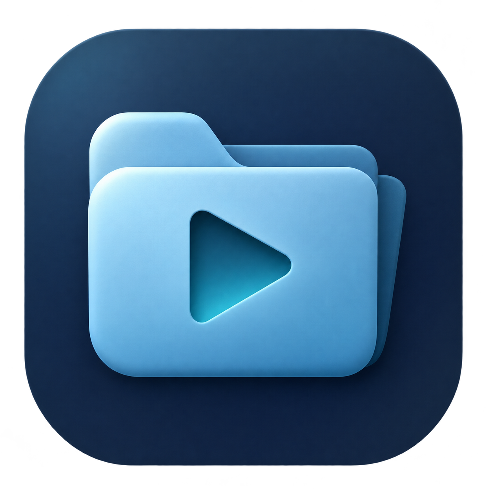
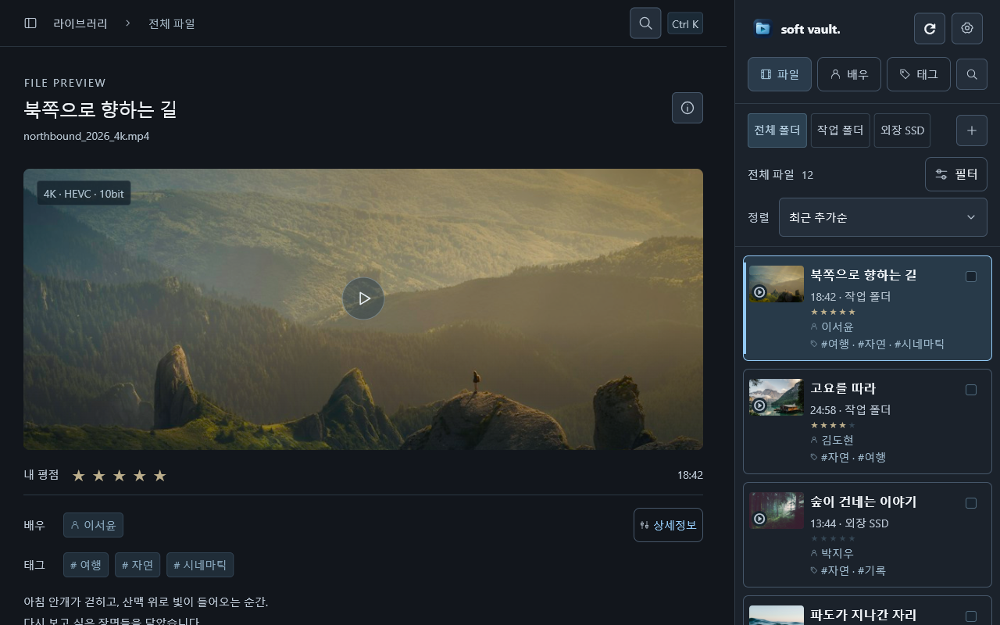
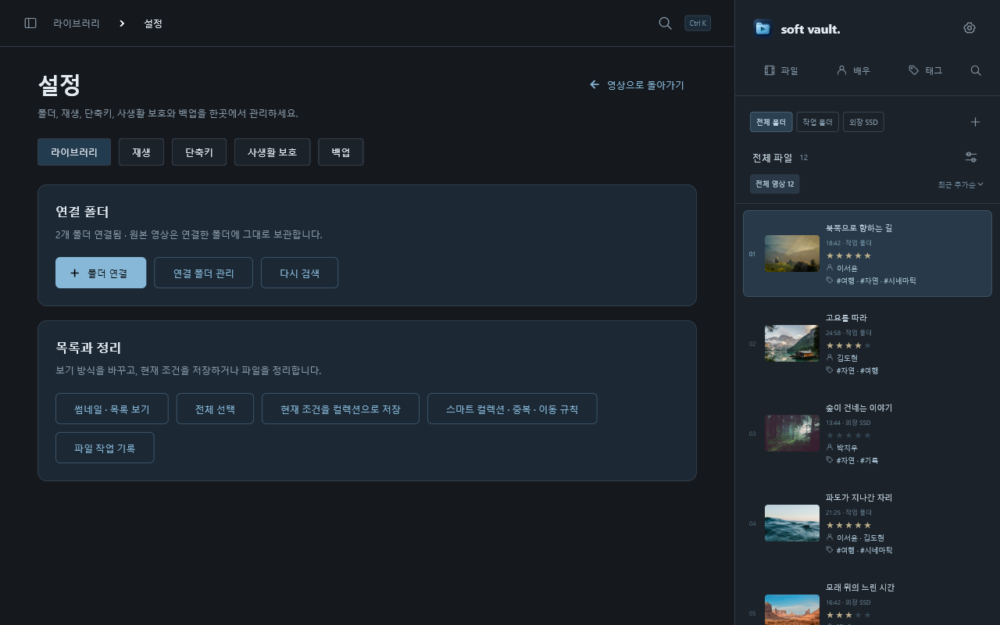
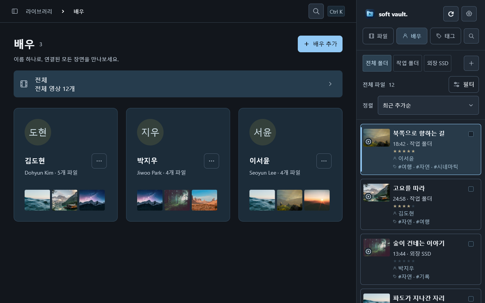
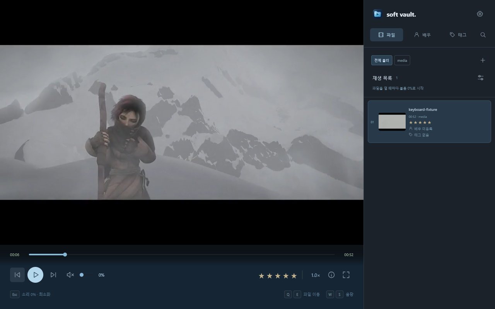
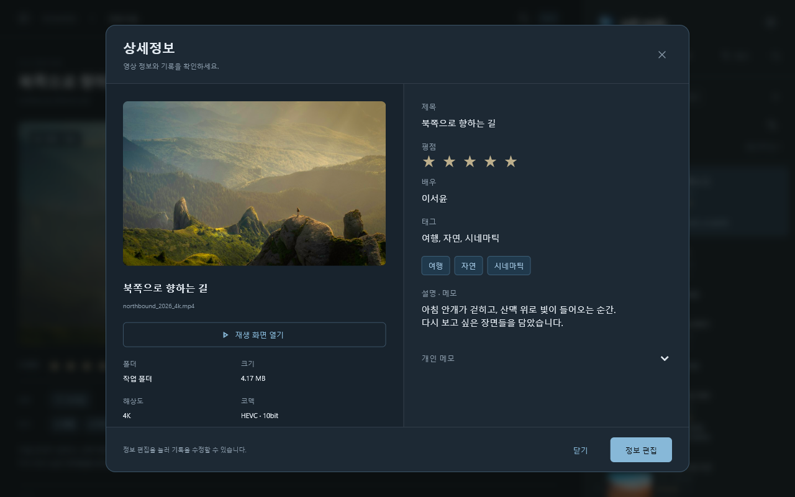
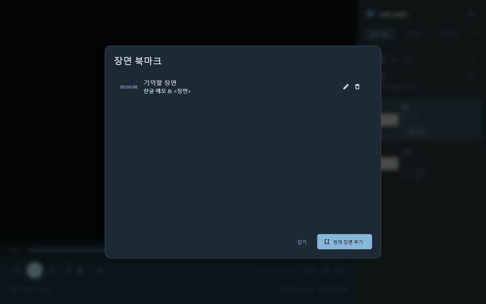
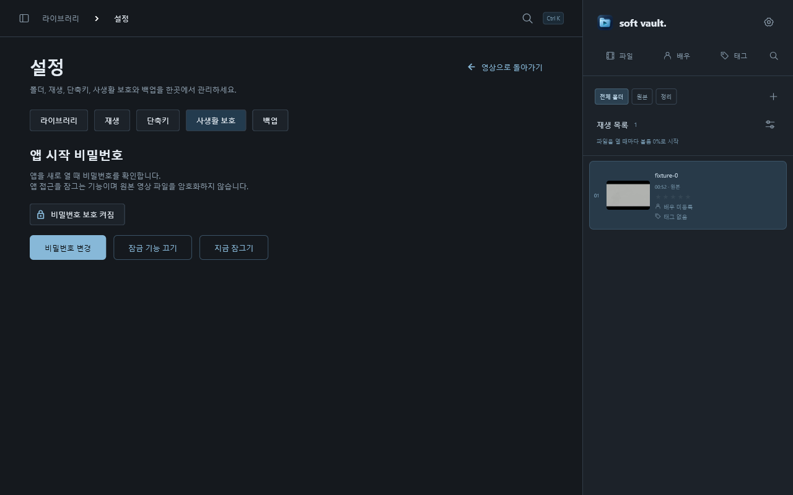
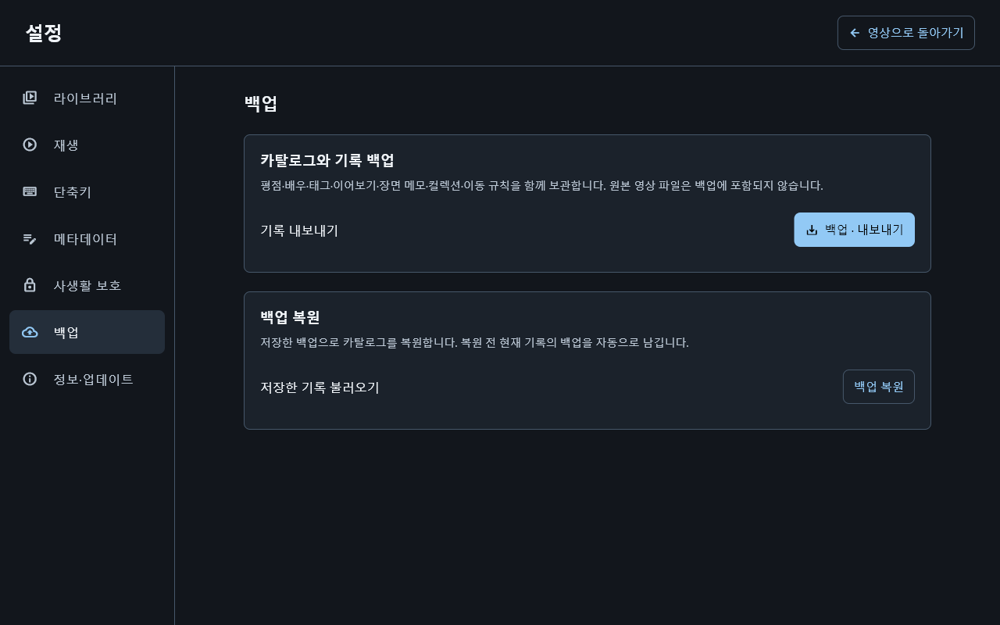

# Soft Vault 사용자 매뉴얼

Soft Vault는 컴퓨터에 보관한 **영상을 찾아보고, 재생하고, 정리하는 데스크톱 앱**입니다. 폴더를 연결하면 영상 목록이 만들어지고, 배우·태그·평점으로 원하는 영상을 찾을 수 있습니다. 원본 영상은 연결한 폴더에 그대로 보관합니다.

[릴리즈 및 다운로드](https://github.com/poyal/soft-vault/releases) · [문제 제보](https://github.com/poyal/soft-vault/issues) · [개발·검증 문서](docs/README.md)

저장소가 비공개이면 다운로드와 문제 제보에도 접근 권한이 필요합니다. 운영체제별 배포 파일과 검증 상태는 해당 릴리즈 노트를 확인해 주세요.

*샘플 자료를 넣은 실제 Windows 앱 화면입니다. 이미지를 누르면 원본 크기로 볼 수 있습니다. [스크린샷 촬영 기록](docs/screenshots/README.md)*

## 목차

- [설치와 첫 실행](#설치와-첫-실행)
- [영상 폴더 연결](#영상-폴더-연결)
- [화면과 검색](#화면과-검색)
- [영상 재생](#영상-재생)
- [배우·태그·평점과 상세정보](#배우태그평점과-상세정보)
- [장면 메모와 대표 썸네일](#장면-메모와-대표-썸네일)
- [컬렉션과 파일 정리](#컬렉션과-파일-정리)
- [앱 시작 비밀번호](#앱-시작-비밀번호)
- [백업과 복원](#백업과-복원)
- [설정과 단축키](#설정과-단축키)
- [업데이트와 문제 해결](#업데이트와-문제-해결)

## 설치와 첫 실행

### Windows

1. 릴리즈에서 Windows x64 ZIP을 내려받아 **전체 압축을 풉니다**.
2. 풀린 폴더의 `app/soft_vault.exe`를 실행합니다.
3. 시작 메뉴에 등록하려면 같은 폴더의 `Install.ps1`을 PowerShell로 실행합니다. 사용자 폴더에 설치되므로 관리자 권한은 필요하지 않습니다.
4. 첫 화면에서 앱 시작 비밀번호를 설정하거나 **나중에 설정**을 선택합니다.

EXE와 함께 들어 있는 `data`, `tools`, DLL 파일이 필요합니다. EXE만 따로 옮기지 마세요. 앱 사용에는 Flutter, Visual Studio, 개발자 모드 또는 별도 코덱 팩을 설치할 필요가 없습니다.

### Mac

Mac 배포 파일의 제공 여부와 설치 방법은 릴리즈 노트를 기준으로 확인해 주세요. Apple Silicon 빌드·설치 검증이 끝난 뒤 해당 파일을 제공합니다. 소스에 macOS 프로젝트가 있다는 것만으로 설치본 검증이 완료된 것은 아닙니다.

## 영상 폴더 연결

1. 오른쪽 위 **soft vault. 옆 톱니바퀴**를 눌러 설정을 엽니다.
2. **라이브러리 → 폴더 연결**에서 영상이 들어 있는 폴더를 선택합니다. 오른쪽 폴더 목록의 **+**로도 연결할 수 있습니다.
3. 검색이 끝나면 목록에서 영상을 선택합니다. 영상 정보와 썸네일은 차례로 채워집니다.
4. 추가한 파일이 보이지 않으면 **설정 → 라이브러리 → 다시 검색**을 누릅니다.

연결한 폴더는 **연결 폴더 관리**에서 관리합니다. 연결을 해제해도 원본 파일은 삭제되지 않습니다. 외장 드라이브를 분리하면 오프라인으로 표시되며, 다시 연결한 뒤 검색하면 상태를 갱신할 수 있습니다.

목록과 재생 대상은 영상입니다. 이미지 선택은 배우 프로필과 대표 썸네일을 지정할 때 사용합니다.

## 화면과 검색

| 위치 | 할 수 있는 일 |
| --- | --- |
| 왼쪽 큰 영역 | 선택한 영상의 미리보기·재생·상세정보 확인 |
| 오른쪽 **파일** | 연결 폴더와 영상 목록 탐색 |
| 오른쪽 **배우**, **태그** | 등록한 배우·태그로 영상 찾기 |
| 돋보기 | 제목·배우·태그 등의 검색 |
| 로고 옆 톱니바퀴 | 라이브러리·재생·단축키·사생활 보호·백업 설정 |

검색은 돋보기 또는 기본 단축키 `Ctrl+K`로 엽니다. 필터와 정렬도 함께 사용할 수 있습니다. **배우·태그 화면의 전체**를 선택하면 검색·폴더·평점·컬렉션 조건을 풀고 전체 영상을 보여 줍니다.

Mac에서는 `Ctrl` 조합 대신 `Command` 조합도 사용할 수 있습니다.

목록에는 길이, 평점, 배우와 태그가 표시됩니다. 긴 배우·태그는 마우스를 올려 전체 내용을 확인할 수 있습니다. **설정 → 라이브러리 → 썸네일 · 목록 보기**에서 보기 방식을 바꿉니다.

## 영상 재생

1. 목록에서 영상을 선택하고 미리보기의 재생 버튼을 누릅니다.
2. **영상 화면을 클릭**하거나 `Space`를 눌러 재생·일시정지를 전환합니다.
3. 아래 재생 막대로 위치를 이동하고, 음량·속도·전체화면을 조절합니다.
4. 다시 열면 저장된 위치에서 이어봅니다. 처음부터 보려면 **설정 → 재생 → 처음부터 재생**을 선택합니다.

**영상을 열 때마다 음량은 0%로 시작합니다.** 소리가 필요하면 음량을 올려 주세요. 화면 클릭으로 일시정지·재생할 때에는 현재 음량을 유지합니다. `Esc`는 음량을 0%로 바꾸고 앱을 최소화합니다.

Mac의 전체화면에서는 전체화면을 해제한 뒤 최소화하며, 복원하면 일반 창으로 돌아옵니다.

영상은 원본 비율을 유지하므로 영상 영역 안에 검은 여백이 생길 수 있습니다. 목록·설정까지 포함한 앱 전체에 검은 테두리가 생기는 것은 정상 동작이 아닙니다.

음성·자막 트랙과 디코더는 **설정 → 재생 → 음성 · 자막 · 디코더**에서 바꿉니다. 외부 플레이어를 쓰려면 **선택 파일 외부 앱으로 열기**를 누릅니다. HDR 파일 재생과 디스플레이의 실제 HDR 출력은 별개이며, 릴리즈의 검증 범위를 확인해 주세요.

## 배우·태그·평점과 상세정보

1. 영상을 선택한 뒤 **상세정보 보기**를 엽니다. 처음에는 읽기 화면으로 표시됩니다.
2. **정보 편집**을 눌러 제목, 배우, 태그, 설명, 메모와 평점을 수정합니다.
3. 저장하면 목록과 검색 결과에도 반영됩니다.

별점은 영상 아래에서도 지정할 수 있습니다. 여러 영상을 선택하면 배우·태그 등 공통 정보를 함께 정리할 수 있습니다. 표시 제목 수정과 원본 **파일 이름 변경**은 서로 다른 작업입니다.

정보를 다른 프로그램과 주고받으려면 **설정 → 재생 → NFO 가져오기 / NFO 내보내기**를 사용합니다. 가져오기는 적용할 내용을 확인한 뒤 실행하며 적용 전 카탈로그를 자동 백업합니다. 기존 NFO를 교체할 때에도 원본 사본을 남깁니다.

## 장면 메모와 대표 썸네일

**설정 → 재생 → 장면 북마크 · 메모**에서 현재 재생 위치와 장면별 메모를 저장합니다. 저장한 장면을 선택하면 해당 위치로 이동할 수 있습니다.

**대표 썸네일 선택**에서는 영상 장면 또는 로컬 이미지로 목록 이미지를 바꿉니다. 원본 영상의 내용은 바뀌지 않습니다. 목록에서 영상 위에 마우스를 올리면 짧은 무음 미리보기를 볼 수 있습니다.

## 컬렉션과 파일 정리

현재 검색·필터를 반복해서 쓰려면 **설정 → 라이브러리 → 현재 조건을 컬렉션으로 저장**을 선택합니다. **스마트 컬렉션 · 중복 · 이동 규칙**에서 저장한 조건과 정리 기능을 관리합니다.

| 기능 | 사용 방법과 결과 |
| --- | --- |
| 스마트 컬렉션 | 조건에 맞는 영상을 다시 모아 봅니다. 원본을 별도 폴더로 복사하지 않습니다. |
| 중복 비교 | 동일·유사 후보를 비교해 정리할 대상을 판단합니다. 후보라는 이유만으로 자동 삭제하지 않습니다. |
| 파일 이동 | 대상을 선택하고 목적지를 지정합니다. 원본 파일의 실제 위치가 바뀝니다. |
| 이동 규칙 | 조건과 목적지를 저장하고 후보를 확인해 실행합니다. 자동 실행은 규칙에서 켠 경우에만 동작합니다. |
| 파일 작업 기록 | 작업 결과와 복구 가능 여부를 확인합니다. 경로 충돌이나 원본 변경이 있으면 복구가 제한될 수 있습니다. |

이동 전에 선택한 영상과 목적지를 확인해 주세요. 외장 드라이브는 작업이 끝날 때까지 연결해 둡니다.

## 앱 시작 비밀번호

1. 첫 실행 화면 또는 **설정 → 사생활 보호**에서 비밀번호를 설정합니다.
2. 8~128자 비밀번호를 두 번 입력합니다.
3. 다음 실행부터 비밀번호를 입력해야 영상 목록을 볼 수 있습니다.
4. 자리를 비울 때는 **지금 잠그기**를 누릅니다. 화면을 가리고 재생을 멈추며 음량을 0%로 바꿉니다.

**비밀번호 변경**과 **잠금 기능 끄기**에는 현재 비밀번호가 필요합니다. 5회 연속 틀리면 잠시 기다린 뒤 다시 시도해야 합니다. 앱 내 비밀번호 복구 기능은 없으므로 기억할 수 있는 비밀번호를 사용해 주세요.

앱 접근을 잠그는 기능이며 원본 영상과 카탈로그 파일을 암호화하지는 않습니다. `Esc`로 최소화하는 것과 비밀번호 잠금은 다릅니다. 카탈로그 백업에는 비밀번호나 잠금 설정이 포함되지 않습니다.

## 백업과 복원

1. **설정 → 백업 → 백업 · 내보내기**를 누릅니다.
2. JSON 파일을 저장할 위치를 정합니다.
3. 복원할 때는 같은 화면의 **백업 복원**에서 저장한 JSON을 선택합니다. 복원 전 현재 기록의 자동 백업을 남깁니다.

| 포함되는 것 | 별도로 보관할 것 |
| --- | --- |
| 제목·배우·태그·평점·메모, 이어보기, 장면 북마크, 컬렉션, 이동 규칙 등 카탈로그 기록 | 원본 영상, 썸네일 이미지 파일·캐시, 앱 잠금 정보 |

다른 PC로 옮길 때는 영상도 별도로 옮겨 주세요. 파일 경로가 달라지면 폴더와 파일을 다시 연결해야 합니다. JSON만 복원해도 영상 자체가 복사되지는 않습니다.

## 설정과 단축키

단축키는 **설정 → 단축키**에서 확인·변경하고 프리셋으로 저장할 수 있습니다. 아래는 기본값입니다. 입력창에서 글을 쓰는 동안에는 재생 단축키가 입력을 가로채지 않습니다.

| 키 | 동작 |
| --- | --- |
| `Space` | 재생·일시정지 |
| `←` / `→`, `A` / `D` | 5초 이동 |
| `Shift+A` / `Shift+D` | 1초 이동 |
| `↑` / `↓`, `W` / `S` | 음량 조절 |
| `M` | 음소거 |
| `Q` / `E` | 이전·다음 영상 |
| `F` | 전체화면 전환 |
| `[` / `]`, `Backspace` | 재생 속도 조절, 1배속 복귀 |
| `1`~`5`, `Shift+0` | 별점, 평점 해제 |
| `Ctrl+K` | 검색 |
| `Esc` | 음량 0% 적용 후 최소화 |

`Esc`와 `0`은 긴급 음소거 용도로 예약되어 변경할 수 없습니다. 추가 단축키와 현재 설정은 앱의 단축키 화면에서 확인해 주세요.

## 업데이트와 문제 해결

업데이트 전 **카탈로그 백업**을 권장합니다. 앱을 정상 종료한 뒤 새 배포 파일의 전체 구성을 설치하세요. 앱 폴더 교체와 카탈로그·영상 원본 삭제는 별개입니다.

| 증상 | 확인할 내용 |
| --- | --- |
| 소리가 나지 않음 | 새 영상의 기본 음량은 0%입니다. 음량과 음성 트랙을 확인하세요. |
| 영상이 목록에 없음 | 연결 폴더와 검색·필터 조건을 확인하고 **다시 검색**을 실행하세요. 이미지 파일은 대상이 아닙니다. |
| 오프라인 표시 | 외장 드라이브 연결과 원본 경로를 확인하세요. 파일을 옮겼다면 다시 연결해야 합니다. |
| 앱이 열리지 않거나 DLL 오류 | ZIP 전체를 풀었는지 확인하세요. EXE만 복사하면 실행되지 않습니다. |
| 화면이 검거나 재생이 느림 | 다른 영상도 같은지 확인하고 **음성 · 자막 · 디코더**에서 재생 설정을 확인하세요. |
| 앱 전체가 느리거나 검은 여백이 생김 | 앱 버전, OS, 창 크기·화면 배율, 발생 동작을 적어 화면과 함께 제보해 주세요. |
| 복원했는데 영상이 없음 | 백업에는 영상 파일이 없습니다. 원본과 연결 경로를 확인하세요. |

문제를 제보할 때는 비밀번호나 사적인 영상 대신 재현 단계와 오류 문구를 보내 주세요. 개발 환경과 테스트 결과는 [문서 안내](docs/README.md), 외부 구성 요소는 [라이선스 고지](THIRD_PARTY_NOTICES.txt)를 참고해 주세요.
