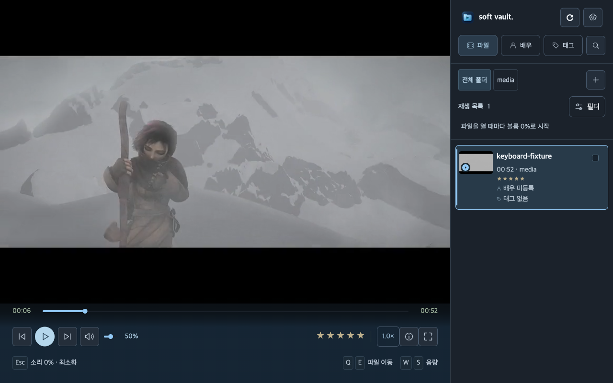

# Soft Vault 사용자 매뉴얼

Soft Vault는 컴퓨터에 보관한 **영상을 찾아보고, 재생하고, 정리하는 데스크톱 앱**입니다. 폴더를 연결하면 영상 목록이 만들어지고, 배우·태그·평점으로 원하는 영상을 찾을 수 있습니다. 원본 영상은 연결한 폴더에 그대로 보관합니다.

[릴리즈 및 다운로드](https://github.com/poyal/soft-vault/releases) · [문제 제보](https://github.com/poyal/soft-vault/issues) · [개발·검증 문서](docs/README.md)

저장소가 비공개이면 다운로드와 문제 제보에도 접근 권한이 필요합니다. 운영체제별 배포 파일과 검증 상태는 해당 릴리즈 노트를 확인해 주세요.

*샘플 자료를 넣은 실제 Windows 앱 화면입니다. 이미지를 누르면 원본 크기로 볼 수 있습니다. [스크린샷 촬영 기록](docs/screenshots/README.md)*

## 목차

- [설치와 첫 실행](#설치와-첫-실행)
- [영상 폴더 연결](#영상-폴더-연결)
- [화면과 검색](#화면과-검색)
- [영상 재생](#영상-재생)
- [배우·태그·평점과 상세정보](#배우태그평점과-상세정보)
- [장면 메모와 대표 썸네일](#장면-메모와-대표-썸네일)
- [컬렉션과 파일 정리](#컬렉션과-파일-정리)
- [앱 시작 비밀번호](#앱-시작-비밀번호)
- [백업과 복원](#백업과-복원)
- [설정과 단축키](#설정과-단축키)
- [업데이트와 문제 해결](#업데이트와-문제-해결)

## 설치와 첫 실행

### Windows

1. 릴리즈에서 **Windows x64 Setup.exe**를 내려받아 실행합니다.
2. 설치 안내를 완료합니다. 기본 설치 위치는 사용자 폴더이며 관리자 권한은 필요하지 않습니다.
3. 시작 메뉴의 **Soft Vault**를 실행합니다.
4. 첫 화면에서 앱 시작 비밀번호를 설정하거나 **나중에 설정**을 선택합니다.

설치 프로그램이 필요한 DLL과 미디어 도구를 함께 설치합니다. 앱 사용에는 Flutter, Visual Studio, 개발자 모드 또는 별도 코덱 팩을 설치할 필요가 없습니다. 제거하려면 Windows 설정의 **앱 → 설치된 앱 → Soft Vault → 제거**를 사용합니다. 카탈로그와 원본 영상은 유지됩니다.

현재 Windows 배포본에는 코드 서명이 없습니다. 다운로드 파일의 SHA-256은 같은 이름의 `.sha256` 파일에서 확인할 수 있습니다.

### Mac

1. 릴리즈에서 **macOS arm64 DMG**를 내려받아 엽니다. Apple Silicon용입니다.
2. `Soft Vault.app`을 옆의 **Applications(응용 프로그램)** 폴더로 드래그한 뒤 디스크를 꺼냅니다.
3. 앱을 실행하고 시작 비밀번호를 설정하거나 **나중에 설정**을 선택합니다. 별도 Flutter나 FFmpeg 설치는 필요하지 않습니다.

현재 Mac 배포본은 로컬 서명이며 Apple Developer ID 서명·공증은 받지 않았습니다. 실행이 차단되면 릴리즈 출처와 체크섬을 확인한 뒤 **시스템 설정 → 개인정보 보호 및 보안 → 확인 없이 열기**를 사용할 수 있습니다. [Apple의 앱 실행 안내](https://support.apple.com/102445)를 참고해 주세요.

*Mac mini M4에서 촬영한 재생 화면입니다. 검증한 OS 버전과 세부 범위는 릴리즈 노트에 기록합니다.*

## 영상 폴더 연결

1. 오른쪽 위 **soft vault. 옆 톱니바퀴**를 눌러 설정을 엽니다.
2. **라이브러리 → 폴더 연결**에서 영상이 들어 있는 폴더를 선택합니다. 오른쪽 폴더 목록의 **+**로도 연결할 수 있습니다.
3. 검색이 끝나면 목록에서 영상을 선택합니다. 영상 정보와 썸네일은 차례로 채워집니다.
4. 추가한 파일이 보이지 않으면 **설정 아이콘 바로 옆의 전체 폴더 새로고침 아이콘**을 누릅니다.

연결한 폴더는 **연결 폴더 관리**에서 관리합니다. 연결을 해제해도 원본 파일은 삭제되지 않습니다. 외장 드라이브를 분리하면 오프라인으로 표시되며, 다시 연결한 뒤 검색하면 상태를 갱신할 수 있습니다.

목록과 재생 대상은 영상입니다. 이미지 선택은 배우 프로필과 대표 썸네일을 지정할 때 사용합니다.

## 화면과 검색

| 위치 | 할 수 있는 일 |
| --- | --- |
| 왼쪽 큰 영역 | 선택한 영상의 미리보기·재생·상세정보 확인 |
| 오른쪽 **파일** | 연결 폴더와 영상 목록 탐색 |
| 오른쪽 **배우**, **태그** | 등록한 배우·태그로 영상 찾기 |
| 돋보기 | 제목·배우·태그 등의 검색 |
| 로고 옆 톱니바퀴 | 라이브러리·재생·단축키·사생활 보호·백업 설정 |

검색은 돋보기 또는 기본 단축키 `Ctrl+K`로 엽니다. 필터와 정렬도 함께 사용할 수 있습니다. **배우·태그 화면의 전체**를 선택하면 검색·폴더·평점·컬렉션 조건을 풀고 전체 영상을 보여 줍니다.

Mac에서는 `Ctrl` 조합 대신 `Command` 조합도 사용할 수 있습니다.

목록에는 길이, 평점, 배우와 태그가 표시됩니다. 긴 배우·태그는 마우스를 올려 전체 내용을 확인할 수 있습니다. **설정 → 라이브러리 → 썸네일 · 목록 보기**에서 보기 방식을 바꿉니다.

## 영상 재생

1. 목록에서 영상을 선택하고 미리보기의 재생 버튼을 누릅니다.
2. **영상 화면을 클릭**하거나 `Space`를 눌러 재생·일시정지를 전환합니다.
3. 아래 재생 막대로 위치를 이동하고, 음량·속도·전체화면을 조절합니다.
4. 다시 열면 저장된 위치에서 이어봅니다. 처음부터 보려면 **설정 → 재생 → 처음부터 재생**을 선택합니다.

**영상을 열 때마다 음량은 0%로 시작합니다.** 소리가 필요하면 음량을 올려 주세요. 화면 클릭으로 일시정지·재생할 때에는 현재 음량을 유지합니다. `Esc`는 음량을 0%로 바꾸고 앱을 최소화합니다.

Mac의 전체화면에서는 전체화면을 해제한 뒤 최소화하며, 복원하면 일반 창으로 돌아옵니다.

영상은 원본 비율을 유지하므로 영상 영역 안에 검은 여백이 생길 수 있습니다. 목록·설정까지 포함한 앱 전체에 검은 테두리가 생기는 것은 정상 동작이 아닙니다.

음성·자막 트랙과 디코더는 **설정 → 재생 → 음성 · 자막 · 디코더**에서 바꿉니다. 외부 플레이어를 쓰려면 **선택 파일 외부 앱으로 열기**를 누릅니다. HDR 파일 재생과 디스플레이의 실제 HDR 출력은 별개이며, 릴리즈의 검증 범위를 확인해 주세요.

## 배우·태그·평점과 상세정보

1. 영상을 선택한 뒤 **상세정보 보기**를 엽니다. 처음에는 읽기 화면으로 표시됩니다.
2. **정보 편집**을 눌러 제목, 배우, 태그, 설명, 메모와 평점을 수정합니다.
3. 저장하면 목록과 검색 결과에도 반영됩니다.

별점은 영상 아래에서도 지정할 수 있습니다. 여러 영상을 선택하면 배우·태그 등 공통 정보를 함께 정리할 수 있습니다. 표시 제목 수정과 원본 **파일 이름 변경**은 서로 다른 작업입니다.

정보를 다른 프로그램과 주고받으려면 **설정 → 재생 → NFO 가져오기 / NFO 내보내기**를 사용합니다. 가져오기는 적용할 내용을 확인한 뒤 실행하며 적용 전 카탈로그를 자동 백업합니다. 기존 NFO를 교체할 때에도 원본 사본을 남깁니다.

## 영상정보와 배우 이미지 보완

1. **설정 → 메타데이터 → 영상정보 교환**에서 **AI 요청문 + 전체 정보 복사**를 누릅니다.
2. 외부 AI에 요청문을 전달하고 반환된 JSON을 **결과 입력**에 붙여넣습니다.
3. **변경 비교**에서 제목·배우·태그·설명의 현재 값과 변경 값을 확인합니다.
4. 배우 이미지가 있으면 **이미지 불러오기**로 미리 본 뒤 **이 배우 이미지 적용**을 체크합니다. 새 배우는 영상의 배우 정보도 함께 선택합니다.
5. **선택한 변경 일괄 적용**으로 저장합니다. 적용 전 정보는 자동 백업합니다.

AI는 배우 이름과 공개 HTTPS 이미지 주소를 반환합니다. 주소 오류·접근 제한 등으로 이미지를 불러오지 못하면 영상정보만 적용할 수 있습니다. 확인한 이미지는 앱 데이터 폴더에 저장하므로 이후 원격 주소가 바뀌어도 등록된 이미지를 사용할 수 있습니다. 기존 이미지 파일은 교체 과정에서 삭제하지 않습니다.

직접 파일을 선택하려면 **설정 → 메타데이터 → 배우 이미지**에서 배우를 검색하고 대표 이미지를 지정합니다. NFO 가져오기·내보내기도 같은 메타데이터 화면에서 사용할 수 있습니다.

## 장면 메모와 대표 썸네일

**설정 → 재생 → 장면 북마크 · 메모**에서 현재 재생 위치와 장면별 메모를 저장합니다. 저장한 장면을 선택하면 해당 위치로 이동할 수 있습니다.

**대표 썸네일 선택**에서는 영상 장면 또는 로컬 이미지로 목록 이미지를 바꿉니다. 원본 영상의 내용은 바뀌지 않습니다. 목록에서 영상 위에 마우스를 올리면 짧은 무음 미리보기를 볼 수 있습니다.

## 컬렉션과 파일 정리

현재 검색·필터를 반복해서 쓰려면 **설정 → 라이브러리 → 현재 조건을 컬렉션으로 저장**을 선택합니다. **스마트 컬렉션 · 중복 · 이동 규칙**에서 저장한 조건과 정리 기능을 관리합니다.

| 기능 | 사용 방법과 결과 |
| --- | --- |
| 스마트 컬렉션 | 조건에 맞는 영상을 다시 모아 봅니다. 원본을 별도 폴더로 복사하지 않습니다. |
| 중복 비교 | 동일·유사 후보를 비교해 정리할 대상을 판단합니다. 후보라는 이유만으로 자동 삭제하지 않습니다. |
| 파일 이동 | 대상을 선택하고 목적지를 지정합니다. 원본 파일의 실제 위치가 바뀝니다. |
| 이동 규칙 | 조건과 목적지를 저장하고 후보를 확인해 실행합니다. 자동 실행은 규칙에서 켠 경우에만 동작합니다. |
| 파일 작업 기록 | 작업 결과와 복구 가능 여부를 확인합니다. 경로 충돌이나 원본 변경이 있으면 복구가 제한될 수 있습니다. |

이동 전에 선택한 영상과 목적지를 확인해 주세요. 외장 드라이브는 작업이 끝날 때까지 연결해 둡니다.

## 앱 시작 비밀번호

1. 첫 실행 화면 또는 **설정 → 사생활 보호**에서 비밀번호를 설정합니다.
2. 8~128자 비밀번호를 두 번 입력합니다.
3. 다음 실행부터 비밀번호를 입력해야 영상 목록을 볼 수 있습니다.
4. 자리를 비울 때는 **지금 잠그기**를 누릅니다. 화면을 가리고 재생을 멈추며 음량을 0%로 바꿉니다.

**비밀번호 변경**과 **잠금 기능 끄기**에는 현재 비밀번호가 필요합니다. 5회 연속 틀리면 잠시 기다린 뒤 다시 시도해야 합니다. 앱 내 비밀번호 복구 기능은 없으므로 기억할 수 있는 비밀번호를 사용해 주세요.

앱 접근을 잠그는 기능이며 원본 영상과 카탈로그 파일을 암호화하지는 않습니다. `Esc`로 최소화하는 것과 비밀번호 잠금은 다릅니다. 카탈로그 백업에는 비밀번호나 잠금 설정이 포함되지 않습니다.

## 백업과 복원

1. **설정 → 백업 → 백업 · 내보내기**를 누릅니다.
2. JSON 파일을 저장할 위치를 정합니다.
3. 복원할 때는 같은 화면의 **백업 복원**에서 저장한 JSON을 선택합니다. 복원 전 현재 기록의 자동 백업을 남깁니다.

| 포함되는 것 | 별도로 보관할 것 |
| --- | --- |
| 제목·배우·태그·평점·메모, 이어보기, 장면 북마크, 컬렉션, 이동 규칙 등 카탈로그 기록 | 원본 영상, 썸네일 이미지 파일·캐시, 앱 잠금 정보 |

다른 PC로 옮길 때는 영상도 별도로 옮겨 주세요. 파일 경로가 달라지면 폴더와 파일을 다시 연결해야 합니다. JSON만 복원해도 영상 자체가 복사되지는 않습니다.

## 설정과 단축키

단축키는 **설정 → 단축키**에서 확인·변경하고 프리셋으로 저장할 수 있습니다. 아래는 기본값입니다. 입력창에서 글을 쓰는 동안에는 재생 단축키가 입력을 가로채지 않습니다.

| 키 | 동작 |
| --- | --- |
| `Space` | 재생·일시정지 |
| `←` / `→`, `A` / `D` | 5초 이동 |
| `Shift+A` / `Shift+D` | 1초 이동 |
| `↑` / `↓`, `W` / `S` | 음량 조절 |
| `M` | 음소거 |
| `Q` / `E` | 이전·다음 영상 |
| `F` | 전체화면 전환 |
| `[` / `]`, `Backspace` | 재생 속도 조절, 1배속 복귀 |
| `1`~`5`, `Shift+0` | 별점, 평점 해제 |
| `Ctrl+K` | 검색 |
| `Esc` | 음량 0% 적용 후 최소화 |

`Esc`와 `0`은 긴급 음소거 용도로 예약되어 변경할 수 없습니다. 추가 단축키와 현재 설정은 앱의 단축키 화면에서 확인해 주세요.

## 업데이트와 문제 해결

업데이트 전 **카탈로그 백업**을 권장합니다. 앱을 정상 종료한 뒤 새 배포 파일의 전체 구성을 설치하세요. 앱 폴더 교체와 카탈로그·영상 원본 삭제는 별개입니다.

| 증상 | 확인할 내용 |
| --- | --- |
| 소리가 나지 않음 | 새 영상의 기본 음량은 0%입니다. 음량과 음성 트랙을 확인하세요. |
| 영상이 목록에 없음 | 연결 폴더와 검색·필터 조건을 확인하고 **다시 검색**을 실행하세요. 이미지 파일은 대상이 아닙니다. |
| 오프라인 표시 | 외장 드라이브 연결과 원본 경로를 확인하세요. 파일을 옮겼다면 다시 연결해야 합니다. |
| 앱이 열리지 않거나 DLL 오류 | Windows 설치 프로그램을 다시 실행해 복구 설치하세요. 설치 폴더 안의 EXE만 따로 옮기면 실행되지 않습니다. |
| 화면이 검거나 재생이 느림 | 다른 영상도 같은지 확인하고 **음성 · 자막 · 디코더**에서 재생 설정을 확인하세요. |
| 앱 전체가 느리거나 검은 여백이 생김 | 앱 버전, OS, 창 크기·화면 배율, 발생 동작을 적어 화면과 함께 제보해 주세요. |
| 복원했는데 영상이 없음 | 백업에는 영상 파일이 없습니다. 원본과 연결 경로를 확인하세요. |

문제를 제보할 때는 비밀번호나 사적인 영상 대신 재현 단계와 오류 문구를 보내 주세요. 개발 환경과 테스트 결과는 [문서 안내](docs/README.md), 외부 구성 요소는 [라이선스 고지](THIRD_PARTY_NOTICES.txt)를 참고해 주세요.

### 앱에서 새 버전 확인

설정의 **앱 정보 · 업데이트**에서 현재 버전과 변경 사항을 확인할 수 있습니다. 자동 확인은 하루 한 번이며 설정에서 끌 수 있습니다. **다운로드** 후 **업데이트 후 재시작**을 누르면 재생 위치를 저장하고 앱을 교체합니다. 나중에 설치하려면 설정을 닫으세요. 진행 중인 파일 작업은 먼저 완료해야 합니다.

업데이트 파일은 서명과 해시를 검증합니다. 다운로드 실패는 다시 시도할 수 있고 기존 앱은 계속 사용할 수 있습니다. 설치 폴더에 쓰기 권한이 없으면 공개 릴리즈의 EXE 또는 DMG로 직접 설치해 주세요. 업데이트 기능이 없는 기존 버전에서는 첫 지원 버전을 직접 설치해야 합니다.

EXE·DMG는 최초 설치용입니다. 릴리즈의 `.svupdate`, `update.json`, `update.json.sig`는 앱이 자동으로 사용하는 업데이트 파일이므로 직접 열 필요가 없습니다. 새 버전 확인은 자동이지만 실제 적용은 **업데이트 후 재시작**을 눌러야 진행됩니다.

### 설정 전용 화면

설정을 열면 영상 목록 대신 왼쪽 분류 메뉴와 오른쪽 설정 본문이 표시됩니다. 라이브러리·재생·단축키·사생활 보호·백업·앱 정보 및 업데이트를 같은 형식으로 확인할 수 있습니다. **영상으로 돌아가기**를 누르면 기존 선택·검색 조건과 목록 스크롤 위치로 돌아갑니다. 설정을 여는 것만으로 영상 재생 상태를 바꾸지 않습니다.

### 별점·배우·태그로 필터링

영상 목록 위의 **필터** 버튼을 누르면 큰 필터 창이 열립니다.

- **평점**: 별을 눌러 1~5점을 선택하고 ‘이상’ 또는 ‘정확히’를 고릅니다. ‘전체’와 ‘미평가’도 선택할 수 있습니다.
- **재생 여부**: ‘전체’, ‘미재생’, ‘재생한 적 있음’을 선택합니다. 이전 버전에 남은 재생 시각·이어보기·시청 완료 기록도 재생 여부에 반영합니다.
- **배우**: 등록된 이름·별칭을 검색하여 여러 명을 선택합니다. 기본은 선택한 배우 중 한 명이라도 포함하는 영상입니다.
- **태그**: 여러 태그를 선택합니다. 기본은 선택한 태그를 모두 포함하는 영상입니다. 배우·태그 각각의 일치 방식을 바꿀 수 있습니다.

평점·배우·태그 조건은 함께 적용됩니다. 기존 검색어·폴더·컬렉션 범위도 유지합니다. **적용**을 눌러야 목록이 바뀌며 취소하면 이전 조건을 유지합니다. 선택한 조건은 목록 위 칩에서 개별 삭제하거나 **필터 해제**로 모두 해제할 수 있습니다. 현재 재생 중인 영상은 필터에서 제외되어도 재생을 계속합니다.

**현재 조건을 컬렉션으로 저장**하면 새 필터 조건도 함께 저장됩니다. 일반 필터 선택은 앱을 종료하면 초기화됩니다.

### 재생 횟수와 이력

**상세정보**에서 재생 횟수와 최근 재생 시각을 확인하고 **재생 이력**을 눌러 날짜·시작 위치별 기록을 볼 수 있습니다. 이력은 최신순으로 표시하며 **더 보기**로 이전 기록을 불러옵니다.

앱에서 영상이 실제로 재생되기 시작하면 1회 집계합니다. 영상을 다시 열거나 끝까지 재생한 뒤 다시 시작하면 새 횟수로 기록합니다. 일시정지 후 재개·구간 탐색·썸네일 미리보기·외부 앱 재생은 횟수를 추가하지 않습니다. 횟수와 상세 이력은 이 기능을 추가한 이후부터 쌓이며, 이전 재생 횟수를 임의로 복원하지 않습니다.

기록은 앱을 다시 열거나 파일을 이동·이름 변경해도 유지되며 카탈로그 백업에 포함됩니다. 동일 경로의 파일 내용이 다른 영상으로 바뀐 경우 해당 영상의 횟수와 이력을 초기화합니다.

목록과 카드의 체크박스는 오른쪽 위에 항상 표시됩니다. 썸네일 왼쪽 아래의 재생 아이콘은 **윤곽이면 미재생**, **파란 채움이면 재생한 적 있음**을 뜻합니다. 아이콘에 마우스를 올리면 상태 설명이 표시됩니다.

### AI로 전체 영상정보 보완하기

목록 위의 화살표 버튼 **영상정보 내보내기·입력하기**에서 전체 라이브러리를 처리합니다. 현재 검색·필터·체크 여부는 대상 범위에 영향을 주지 않습니다.

1. **AI 요청문 + 전체 정보 복사**를 눌러 외부 AI에 붙여넣습니다. 큰 자료는 **전체 정보 JSON 저장** 후 **요청문만 복사**하여 파일과 함께 전달합니다.
2. AI 답변을 **입력하기 → 결과 붙여넣기** 또는 **JSON 파일 열기**로 불러옵니다.
3. **변경 비교**에서 현재 값과 제안을 확인하고 적용할 필드를 선택한 뒤 **선택한 변경 일괄 적용**을 누릅니다.

사용 가이드와 요청문은 창 안에서 열고 복사할 수 있습니다. 제목·배우·태그·설명과 파일명만 내보내며 영상 파일·전체 경로·개인 메모·평점·재생 기록은 제외합니다. 배우·태그 제안은 선택 적용하면 해당 목록을 교체합니다. 누락된 영상과 비어 있는 필드는 유지합니다.

내보낸 요청은 앱을 다시 열어도 보관됩니다. **현재 정보로 새 요청 만들기**는 이전 요청을 대체하므로 이전 AI 답변은 적용할 수 없습니다. 내보낸 후 원본 정보가 바뀌면 새 요청으로 다시 비교해야 합니다. 적용 전 카탈로그를 자동 백업하고 선택한 변경을 한 번에 저장합니다. 기존 NFO 가져오기·내보내기도 계속 사용할 수 있습니다.
