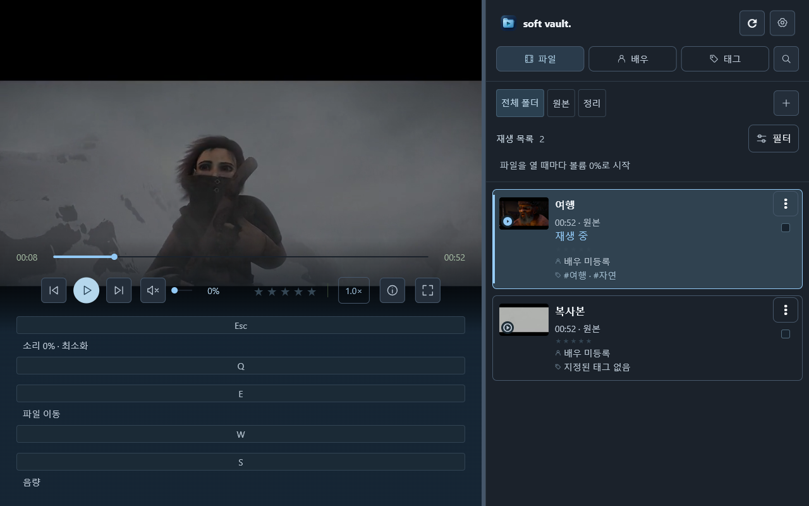
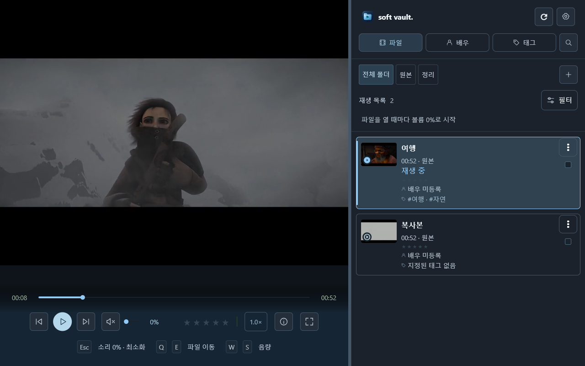
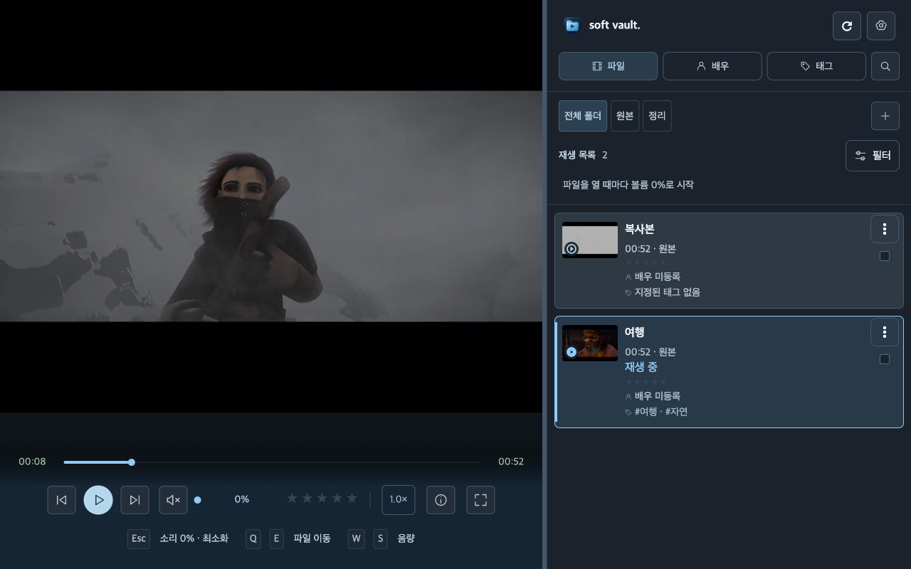

# 0.3.1 스크린샷 검수

Windows x64와 Mac arm64의 실제 Flutter 네이티브 화면을 캡처하고 이미지로 검수했다. 사용자 데이터 대신 합성 카탈로그·시험 영상을 사용했다. 화면만 보고 기능 동작을 추정하지 않고 같은 화면의 UI 테스트 결과와 함께 판정한다.

## 범위

| 캡처 묶음 | 조건 | 플랫폼별 이미지 수 |
| --- | --- | ---: |
| 주요 화면 15종 | 1000×700, 1280×800, 1440×900 | 45 |
| 라이브러리·재생·디자인·잠금 E2E | 주로 1280/1440, native 전체화면 포함 | 72 |
| 설정 패널 | 단축키·라이브러리·백업·사생활·정보·재생 | 6 |

주요 15종은 목록, 그리드, 상세정보, 배우 목록, 배우 편집, 태그, 필터, 라이브러리 설정, 단축키 설정, 재생 설정, 메타데이터 내보내기 안내, 내보내기, 입력, 배우 이미지 목록, 이미지 편집이다.

추가 E2E는 실제 영상·디코더 설정·전체화면, 폴더·이동 전후, 검색, 빈 라이브러리·오프라인·다중 선택·검색 결과 없음, 장면·썸네일·컬렉션·중복·이동 규칙·미리보기, 잠금·실패·대기·저장 오류 상태를 포함한다.

9장씩 묶은 접촉 시트로 각 이미지를 확인하고 의심되는 부분은 원본 크기로 확대했다. 긴 설정 내용과 배우 이미지 편집은 작은 창에서 스크롤되는 구성이다. 보이는 목록의 마지막 행 일부가 화면 경계에 걸리는 것은 스크롤 영역이며 고정 하단 작업 버튼의 누락과 구분했다.

## 발견과 수정

재생 화면의 Esc/Q/E/W/S 키캡이 가로 전체 너비로 확장되어 단축키 설명이 여러 큰 행을 차지하고 영상 영역을 밀어냈다. `KeyCap`의 정렬 컨테이너를 내용 너비에 맞추고 Wrap 회귀 검사를 추가했다. 수정 전 캡처도 보존한다.

1280/1440 재생·hover 미리보기 재캡처에서 작은 키캡과 안내 문구가 한 줄로 표시되는지, 영상·탐색 바·재생 버튼을 가리지 않는지 확인했다. 선택·재생 표시, 한국어 줄바꿈, 메뉴·모달·고정 하단 버튼의 배치도 대조한다.

## 증거와 제한

- 원본: Windows `build/e2e`, `build/release-screen-review`, `build/settings-native-review`; Mac 별도 후보의 같은 경로.
- 검수용 사본·접촉 시트: `build/release-031/mac-screens`, `mac-sheets-*` 및 Windows 최종 캡처 묶음.
- 최종 이미지 246장의 목록·크기·SHA-256은 [screenshot-manifest.json](screenshot-manifest.json)에 고정했다. Windows의 이전 날짜 캡처 4장은 제외했다.
- 설정 정보 화면의 `0.1.0+1`은 테스트 fixture에서 주입한 버전이다. 실제 0.3.1 배포 버전은 설치 사본과 서명 manifest에서 확인한다.
- 모든 OS 배율·글꼴 확대·스크린리더·물리 HDR 출력·모든 사용자 데이터 조합을 검증한 결과는 아니다.

최종 결과: Windows 123장·Mac 123장, 총 246장 검수 완료. 검수한 범위에서 추가 표시 결함은 발견하지 못했다.

## 수정 전후

